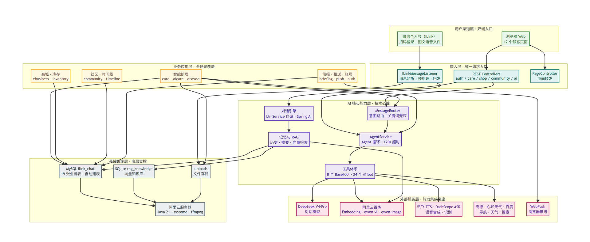
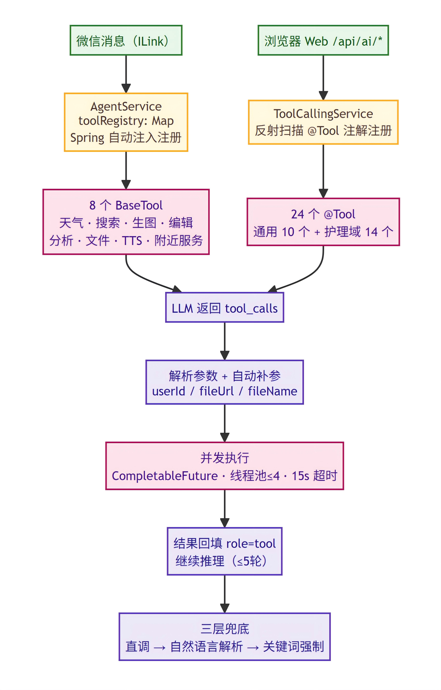
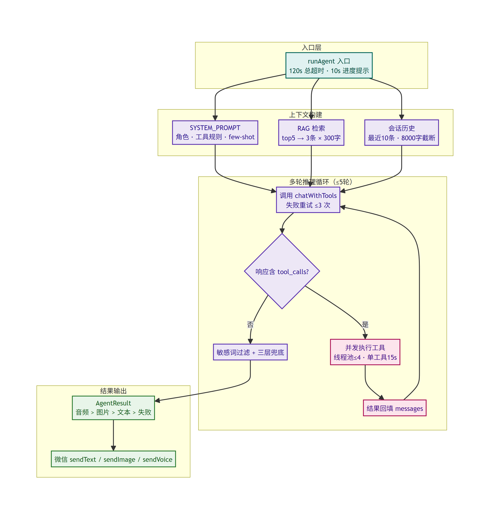
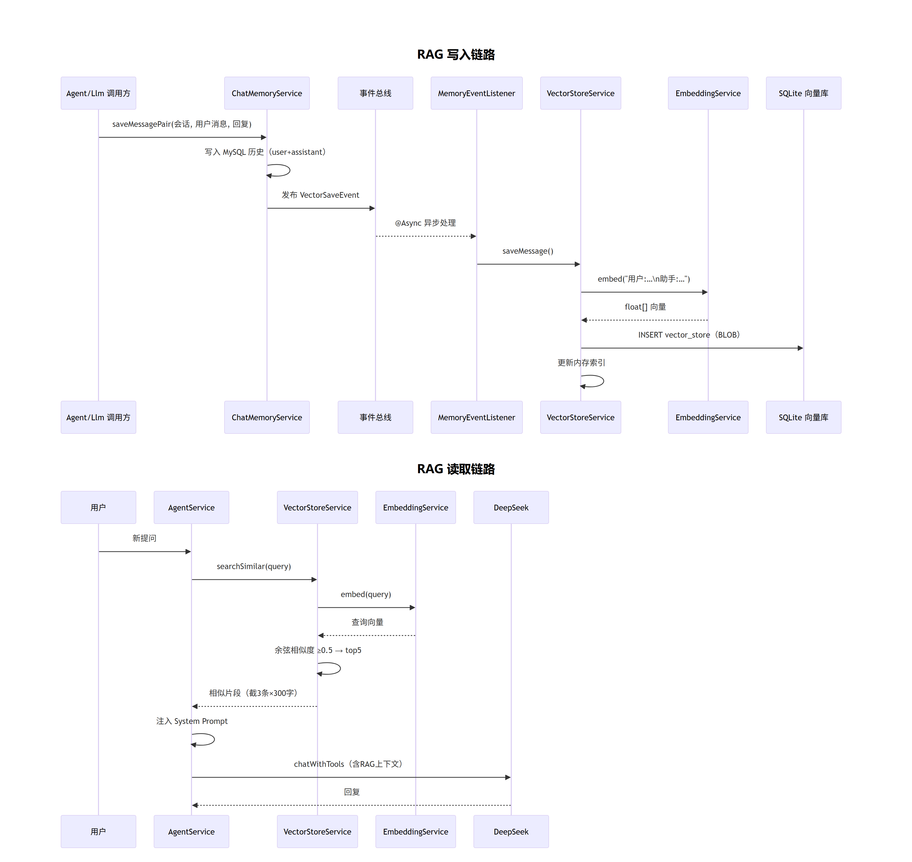

<div align="center">

# 🌿 Plant Agent · 微信 ILink × AI 智能助手平台

**以微信聊天机器人为入口的宠物 / 绿植护理 AI Agent 平台：识别、问答、提醒、生图、语音，一站式完成**


[](https://github.com/sekai-lyr/plant-agent/stargazers)
[](.github/workflows/build.yml)

</div>

---

## 📖 项目简介

用户通过**微信（ILink 个人号 / 公众号）或浏览器**，用文字、图片、语音、文件与 AI Agent 交互：

- 🐱 **宠物 / 绿植识别与健康评估**——拍照上传，qwen-vl 视觉模型分析
- 💬 **智能对话 + 记忆**——DeepSeek 大模型 + SQLite RAG 向量库长期记忆
- 🔔 **护理提醒与简报**——浇水/喂食提醒、每日 briefing 推送
- 🛠 **Agent 工具调用**——天气、地图、搜索、生图、TTS 等 8+ 工具自主编排
- 🛒 **Web 全家桶**——商城、社区、库存、时间线等 12 个静态页面配套功能

## 🏗️ 架构展示

| 六层解耦架构 | Agent 工具调用体系 |
|:---:|:---:|
|  |  |
| **Agent 执行引擎** | **RAG 记忆时序** |
|  |  |

## ✨ 核心特性

- **🤖 Agent 执行引擎**：意图路由 → 工具编排 → 结果校验，`BaseTool` 插件式扩展，新增工具只需一个类
- **🧠 RAG 长期记忆**：SQLite 向量库存储对话知识，让机器人"记得住"每只宠物每株植物
- **👁 多模态全链路**：视觉理解（qwen-vl）· 图像生成/编辑（qwen-image）· 语音识别（DashScope ASR）· 语音合成（讯飞 TTS）
- **🔗 丰富外部工具**：心知天气 · 高德地图 · 百度搜索 · WebPush 消息推送
- **💬 三端入口**：微信个人号（ILink）· 微信公众号 · 浏览器 Web
- **🧩 六层解耦架构**：router → agent → service → core → utils，模块边界清晰（24 个业务包）

## 📂 项目结构

```text
Plant_Agent/
├── src/main/java/com/example/demo/
│   ├── agent/          # Agent 核心：执行引擎、工具定义、敏感词过滤
│   │   └── tools/      # 8+ 可插拔工具（图像分析/生成/编辑、文件、TTS、搜索…）
│   ├── ai/             # Spring AI 集成：Chat / ToolCalling
│   ├── wechat/         # 微信 ILink / 公众号接入
│   ├── vision/ imagegen/ asr/ tts/   # 多模态能力
│   ├── care/ disease/ briefing/      # 护理、疾病、简报业务
│   ├── ebusiness/ community/ inventory/ timeline/  # Web 功能
│   ├── kb/             # RAG 知识库
│   └── ...             # 共 24 个业务包 / 149 个 Java 文件
├── src/main/resources/
│   ├── static/         # 12 个前端页面（chat / care / community / briefing…）
│   └── db/             # 数据库 Schema
├── 落地文档/            # 📚 完整设计文档（架构、工具体系、RAG、学习指南）
└── .github/workflows/  # CI 构建流水线
```

## 📚 落地文档（强烈推荐阅读）

| 文档 | 内容 |
|---|---|
| [项目知识文档](落地文档/项目知识文档.md) | 架构、模块、流程、数据库、配置、部署全景 |
| [项目介绍与记忆RAG系统设计](落地文档/项目介绍与记忆RAG系统设计.md) | RAG 长期记忆的设计与实现 |
| [Agent工具调用体系](落地文档/Agent工具调用体系.md) | 插件式工具体系的设计哲学 |
| [架构图-六层解耦](落地文档/架构图-六层解耦.md) / [纵向架构](落地文档/架构图-纵向架构.md) | 架构决策记录 |
| [Java学习指南-基于本项目代码](落地文档/Java学习指南-基于本项目代码.md) | 以本项目为例的 Java 学习路径 |

## 🚀 快速开始

```bash
# 环境要求：JDK 21 · MySQL 8 · Maven Wrapper 已内置
git clone https://github.com/sekai-lyr/plant-agent.git
cd plant-agent

# 1. 配置密钥（所有敏感配置走环境变量，模板见 application.properties）
cp src/main/resources/application.properties src/main/resources/application-local.properties
#    在 application-local.properties 中填入你的 DASHSCOPE_API_KEY / DEEPSEEK_API_KEY 等
#    （application-local.properties 已被 .gitignore 排除，不会泄漏）

# 2. 初始化数据库（MySQL 中创建 ilink_chat 库后自动建表）

# 3. 启动
./mvnw spring-boot:run
```

> 各外部服务（天气/地图/TTS…）均支持降级运行——缺哪个 key 就关哪项能力，核心对话不受影响。

## 🛠️ 技术栈

`Java 21` · `Spring Boot 3.5` · `Spring AI 1.0` · `DeepSeek V4-Pro (OpenAI 兼容)` · `qwen-vl / qwen-image` · `MySQL 8 + SQLite(RAG)` · `原生 HTML/CSS/JS`

---

<div align="center">

**如果这个项目对你有帮助或启发，欢迎点一个 ⭐ Star 支持一下！**

*Made with ❤️ by [sekai-lyr](https://github.com/sekai-lyr) · 更多项目见 [sekai-product](https://github.com/sekai-lyr/sekai-product)*

</div>
